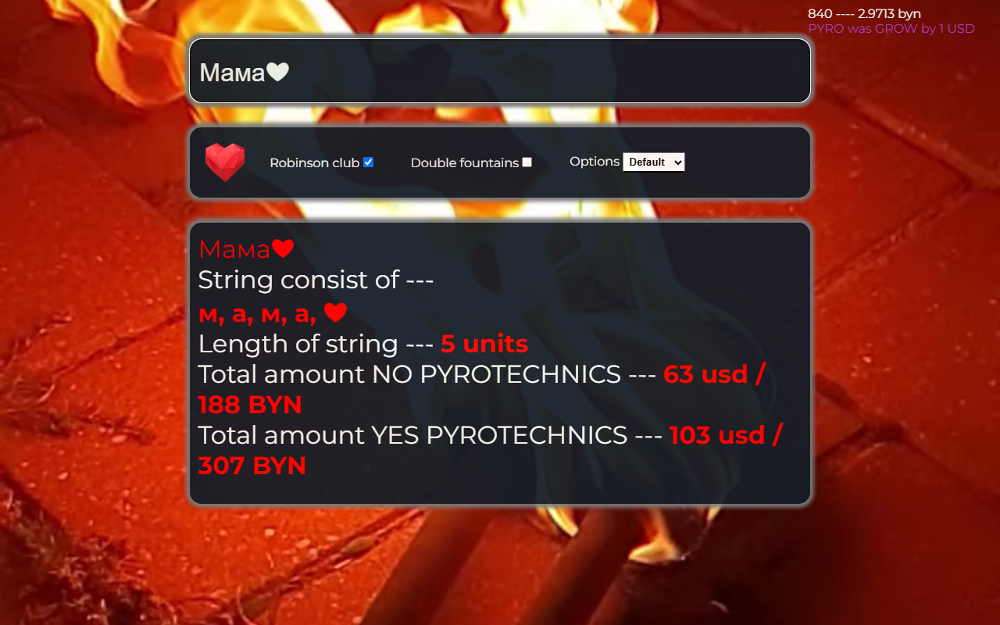

# 🔥 Letters Cost Calculator

A small web app that calculates the price of a **fire letters show** — a burning inscription (names, words,
hearts) for events — and checks whether the inscription can be assembled from the letters available in stock.

▶️ **Live demo:** https://girgen2019.github.io/Calculate-the-cost-of-letters-V2/



## Features

- **Instant price** while typing: the inscription, its letters and the number of units are shown live.
- **Two prices at once:** without pyrotechnics and with pyrotechnics, in **USD and BYN**.
- **Live exchange rate:** the official USD rate is loaded from the National Bank of Belarus API
  (`https://api.nbrb.by/exrates/rates/431`) and shown in the header.
- **Weather at the venue:** forecast for **Robinson Club** (Minsk District, shore of the Minsk Sea,
  fixed coordinates `53.9508, 27.3387`) from [Open-Meteo](https://open-meteo.com/). Pick any date from today
  up to 15 days ahead — the weather for that day is shown at once: weather icon (hover for the conditions),
  min/max temperature and max wind. The rate and the weather are shown as two matching chips in the header.
- **Options:**
  - ❤ button — adds a heart to the inscription;
  - **Robinson club** — venue surcharge (on by default);
  - **Double fountains** — extra pyrotechnic fountains.
- **Checking letters** mode (Options → Checking letters): a dialog in the calculator style — type a word and see which letters can be taken from
  the physical set in stock and which ones are missing, shown as letter tiles with counters. It opens and closes
  with a fade/scale animation; close with ✕, Esc or a click outside.
- Fullscreen video background and responsive layout (5 breakpoints, down to 399 px).

## How the price is calculated

Spaces are ignored; every other character is one unit.

```
base         = ceil( (letters × 15 + hearts × 25 − 30) / 2 + 30 + fountains )
pyrotechnics = ceil( (letters × 15 + hearts × 25 − 30) / 2 + 30 + (letters + hearts) × 8 + fountains )

fountains    = 16 USD if "Double fountains" is checked, otherwise 0
total        = base or pyrotechnics + 5 USD if "Robinson club" is checked
BYN          = USD × official NBRB rate (rounded up)
```

**Example — "Мама❤"** (4 letters + 1 heart, Robinson club on):

| | Calculation | Result |
|---|---|---|
| Without pyrotechnics | (60 + 25 − 30) / 2 + 30 = 57.5 → 58, + 5 | **63 USD** |
| With pyrotechnics | 57.5 + 5 × 8 = 97.5 → 98, + 5 | **103 USD** |

## Checking letters

The stock is a fixed set of physical letters (for example `е` × 5, `н` × 3, `я` × 3, `б` × 1).
The checker takes letters from the set one by one, so a word that needs more copies of a letter than are
available shows the extra ones as **NOT Found**.

## Tech stack

`HTML5` `CSS3` (Flexbox, media queries) `JavaScript (ES6, no frameworks)` `Fetch API`
`REST API (NBRB, Open-Meteo)` `GitHub Pages`

## Run locally

No build step is needed:

```bash
git clone https://github.com/girgen2019/Calculate-the-cost-of-letters-V2.git
cd Calculate-the-cost-of-letters-V2
```

Open `index.html` in a browser. An internet connection is needed for the exchange rate, the weather forecast and Google Fonts.

## Project structure

```
index.html          page layout: input, options, result block, video background
js_App-calc.js      price calculation, letters check, NBRB rate and Open-Meteo weather
style-calc.css      styles and responsive breakpoints
assets/             background video (webm + mp4), icons, favicon
docs/screenshot.png screenshot for this README
```

GitHub Pages lets browsers cache files for 10 minutes, so `index.html` loads the CSS and JS with a version
query (`style-calc.css?v=20261022`). **After changing the CSS or JS, bump this value** — otherwise visitors can
get the new page with the old styles or script.

## Exchange rate handling

- The rate and its date are read from the NBRB response **by field name** (`Cur_OfficialRate`, `Date`), so new
  fields in the API response do not break the label.
- If the API is unavailable, the page says so and shows `BYN n/a` instead of `NaN`; USD prices still work.
- If the rate arrives after the user has already typed, the prices are recalculated automatically.

Weather data by [Open-Meteo.com](https://open-meteo.com/) (CC BY 4.0).
